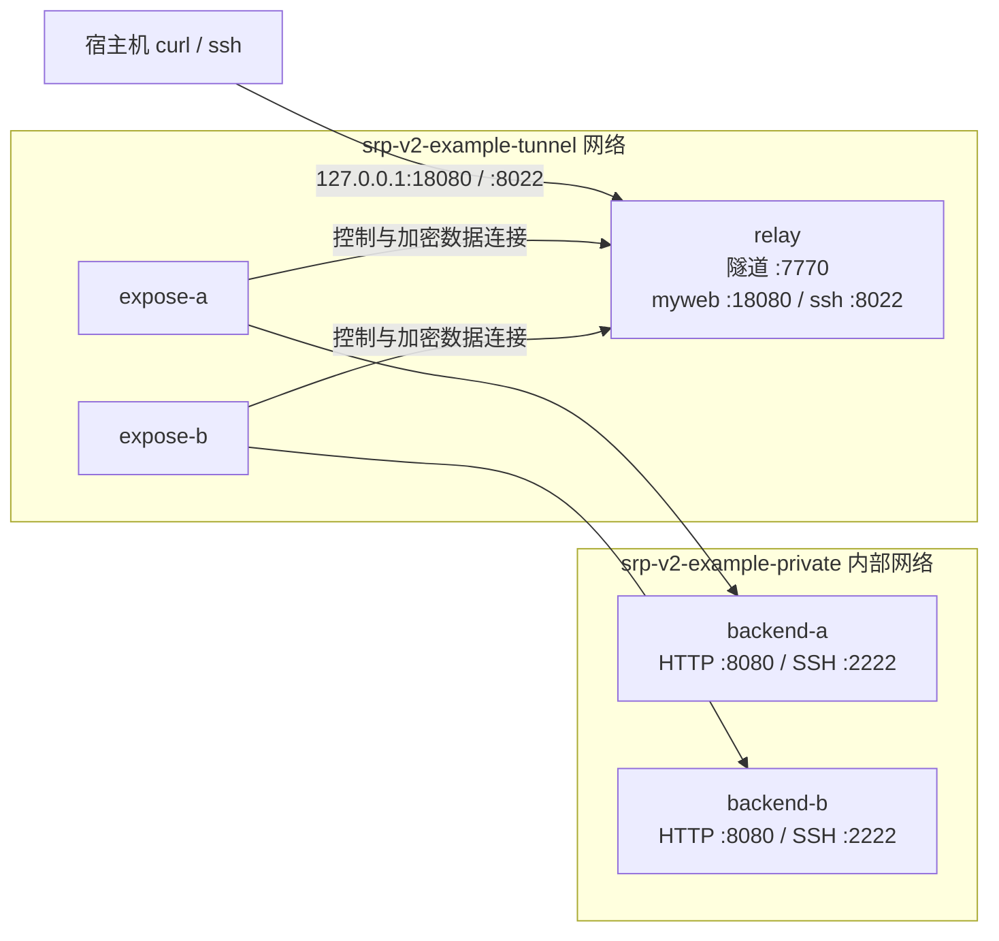

# Podman 完整示例

在一台机器上模拟公网 relay 和内网 expose：两个 expose 各自提供真实的 HTTP、OpenSSH 服务，同名服务由 relay 按新连接轮询。不需要 Compose 或宿主机 Go，srp 全部通过命令行参数启动。

## 拓扑



relay 仅加入 tunnel 网络，后端仅加入 private 网络；expose 同时加入两个网络。后端不发布宿主机端口，客户端访问经过 srp。生产中可将后端换成 expose 能连接到的任意 TCP 地址。

## 启动

宿主机需要 Bash、Podman、OpenSSL、OpenSSH 客户端（含 `ssh-keygen`）和 curl。使用同一个普通用户运行命令，不要混用 `podman` 和 `sudo podman`。

```sh
cd examples/podman
./demo.sh up
./demo.sh check
```

`up` 构建两个镜像、创建两个网络和五个容器，在 Git 忽略的 `.state/` 目录（权限 700）生成密钥：

| 文件 | 用途 |
| --- | --- |
| `shared.key` | 三个 srp 容器共用的 32 字节原始密钥，只读挂载 |
| `id_ed25519` | 宿主机 SSH 私钥，不挂载到容器 |
| `id_ed25519.pub` | 只读挂载到后端，授权 demo 用户登录 |

再次启动复用密钥，不覆盖已有文件。构建上下文通过 `.containerignore` 排除 `.state/`，每个后端在容器内独立生成 SSH host key。

默认基础镜像是 `docker.io/library/golang:1.24-alpine` 和 `docker.io/library/alpine:3.23`，后端构建还需访问 Alpine 软件源安装 OpenSSH 和 BusyBox extras。可以指定本机缓存的兼容镜像：

```sh
SRP_GO_IMAGE=docker.io/library/golang:1.24-alpine \
SRP_ALPINE_IMAGE=docker.io/library/alpine:3.23 \
./demo.sh up
```

如果宿主机代理环境变量指向 `127.0.0.1`，隔离的构建容器无法连接该代理，可再加 `SRP_BUILD_NETWORK=host`：

```sh
SRP_BUILD_NETWORK=host ./demo.sh up
```

此选项仅影响构建网络，运行时仍使用图中的两个独立网络。

## 使用 HTTP 和 SSH

连续请求交替返回两个后端，起始顺序取决于注册顺序：

```sh
curl --noproxy '*' http://127.0.0.1:18080/
# srp backend-a
curl --noproxy '*' http://127.0.0.1:18080/
# srp backend-b
```

登录真实 SSH 服务：

```sh
./demo.sh ssh
# 登录后执行：
cat /etc/srp-example-name
exit
```

直接执行远程命令：

```sh
ssh -F /dev/null -i .state/id_ed25519 -p 8022 \
  -o IdentitiesOnly=yes -o StrictHostKeyChecking=no \
  -o UserKnownHostsFile=/dev/null demo@127.0.0.1 \
  'cat /etc/srp-example-name'
```

两个后端有不同的 SSH host key，演示命令因此关闭该地址的 host key 检查，不修改用户 SSH 配置或 known_hosts。后端只允许 demo 用户公钥登录，禁用密码登录和 root 登录。

所有发布端口仅绑定宿主机 `127.0.0.1`：7770 为隧道入口，8022 转发到后端 SSH 2222，18080 转发到后端 HTTP 8080。

## 自动验证

`./demo.sh check` 检查 HTTP、SSH 轮询，然后暂时停止全部 expose，检查 relay 服务监听关闭，重启 expose 后检查转发恢复。因此运行 check 会中断已有演示连接；失败时也会尝试重新启动 expose。

```text
PASS: HTTP reaches both private backends in round-robin order
PASS: SSH public-key login reaches both private backends
PASS: removing all exposes closes both relay service listeners
PASS: restarting exposes restores HTTP and SSH forwarding
```

`up` 还会在启动 expose 前确认 relay 只监听 7770。Podman 的宿主机端口映射在创建容器时就存在，动态 listener 检查因此在 relay 容器内部进行。

## 实际 srp 命令

relay 容器内：

```sh
srp -v relay -k /run/srp/shared.key -l :7770 \
  -s 'ssh=:8022,myweb=:18080'
```

expose-a 内：

```sh
srp -v expose -k /run/srp/shared.key -r relay:7770 \
  -t 'ssh=backend-a:2222,myweb=backend-a:8080'
```

expose-b 的目标改为 `backend-b:2222`、`backend-b:8080`。这些名称由 Podman 网络 DNS 解析。

## 查看和清理

```sh
./demo.sh status
./demo.sh logs
podman logs -f srp-v2-example-relay
./demo.sh down
```

`down` 可重复运行，也可清理启动失败留下的部分资源。它只删除名称和标签均匹配的示例容器、网络，不操作其他 Podman 资源，不删除镜像或 `.state/` 密钥。

端口占用时，先释放宿主机 7770、8022、18080，再运行 down、up。重复运行 up 会提示先运行 down，不会替换已有容器。
